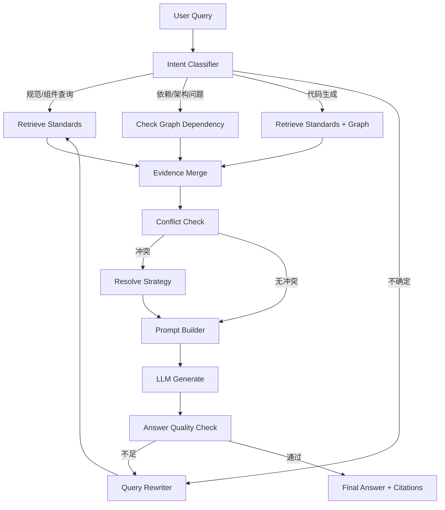

# Agent 化方案：流程图、工具路由策略、接口契约与 MCP 封装

> 目标：在现有 Shared-only 能力基础上，引入“Agent 自主选择工具 + 多步迭代”的能力，同时仍可通过 MCP 对接 Claude Code。

---

## 1. Agent 化流程图（含工具路由）



**说明**
- “Intent Classifier”可用规则/轻量模型实现（关键词、置信度）。
- “Quality Check”可基于答案长度、引用覆盖率、冲突提示是否包含等规则。
- “Query Rewriter”用于不确定场景，扩大检索召回。

---

## 2. 工具路由策略（可执行规则）

### 2.1 路由规则（示例）
| 触发条件 | 工具调用 | 备注 |
| --- | --- | --- |
| 含“组件/使用/示例” | `retrieve_standards` | 组件/规范检索 |
| 含“依赖/上下游/架构” | `check_graph_dependency` | 图谱依赖 |
| 含“生成/代码/模板” | `retrieve_standards` + `check_graph_dependency` | 组合调用 |
| 置信度 < 0.5 | `query_rewrite` | 扩大召回 |
| 检索命中 < k | `query_rewrite` + 再检索 | 强制兜底 |

### 2.2 策略伪代码
```ts
if intent in ["component", "standard"]:
  call retrieve_standards
if intent == "dependency":
  call check_graph_dependency
if intent == "codegen":
  call retrieve_standards
  call check_graph_dependency
if confidence < 0.5 or results < k:
  rewrite query and retry
```

### 2.3 冲突处理策略
- 若规范冲突：明确指出冲突并以规范优先
- 若依赖缺失：提示需补齐或替代组件
- 若来源不足：要求补充上下文

---

## 3. Agent 接口契约（核心）

### 3.1 Agent 请求
```json
{
  "query": "如何在 Modal 中使用 Button 并符合规范？",
  "user_id": "u123",
  "top_k": 5,
  "context": {
    "language": "typescript",
    "project": "frontend"
  }
}
```

### 3.2 Agent 响应
```json
{
  "answer": "...",
  "citations": [
    {"source": "ui/button.md", "score": 0.82}
  ],
  "tool_trace": [
    {"tool": "retrieve_standards", "status": "ok"},
    {"tool": "check_graph_dependency", "status": "ok"}
  ],
  "warnings": ["dependency missing: Theme"],
  "meta": {
    "intent": "codegen",
    "confidence": 0.74
  }
}
```

### 3.3 错误返回
```json
{
  "error": {
    "code": "SERVICE_UNAVAILABLE",
    "message": "vector store unavailable"
  }
}
```

---

## 4. 工具接口契约（Agent 内部调用）

### 4.1 `retrieve_standards`
```json
{
  "query": "Button 组件最佳实践",
  "top_k": 5
}
```

### 4.2 `check_graph_dependency`
```json
{
  "component_name": "Button"
}
```

### 4.3 `query_rewrite`（新增）
```json
{
  "query": "如何在 Modal 中使用 Button",
  "strategy": "expand"
}
```

---

## 5. MCP 封装方式（推荐）

### 5.1 方案 A：暴露单一 Agent 工具（推荐）
**工具名**：`run_agent`

**输入**
```json
{
  "query": "...",
  "user_id": "u123",
  "top_k": 5,
  "context": {"language": "typescript"}
}
```

**输出**
```json
{
  "answer": "...",
  "citations": [...],
  "tool_trace": [...],
  "warnings": [...]
}
```

**优点**
- Claude Code 只需要调用一个工具
- Agent 内部控制复杂流程

### 5.2 方案 B：同时暴露基础工具 + Agent 工具
**工具**
- `retrieve_standards`
- `check_graph_dependency`
- `run_agent`

**优点**
- Claude Code 可选择“手动工具链”或“Agent 一键”

---

## 6. MCP Server 示例伪代码

```ts
register_tool("run_agent", async (args) => {
  const result = await agent.run(args);
  return result;
});
```

---

## 7. 与 Shared-only 的兼容约束
- `ENABLE_PRIVATE_INGESTION=false`
- Agent 内部 **不调用** 任何私有检索
- `get_personal_context` 可保留但默认返回空

---

## 8. 迁移建议
- **一期**：固定流程 MCP 工具
- **二期**：引入 Agent（上述 run_agent 工具）
- **三期**：启用 Private Layer + 更复杂策略
